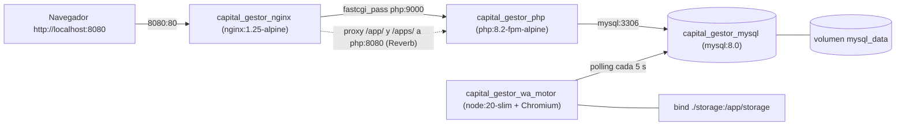

# 01 — Mapa del Proyecto y Arquitectura Base

> Auditoría: 2026-11-07 · Rama auditada: `refactor/purga-codigo-muerto` (HEAD `6c191da`, igual a `main`).
> Convenciones: **[HECHO]** verificado con `archivo:línea` · **[INFERENCIA]** deducción por convención · **[DUDA]** requiere validación del dueño · `❓ NO DETERMINABLE CON EL CÓDIGO`.

---

## 0. Validación del contexto de negocio (léase primero)

El brief describe el sistema como **"Taller Velázquez (Capital Gestor)"**, un POS para taller mecánico con dominio local `http://TallerVelazque.com` y scripts `iniciar_windows.bat`. **El código no respalda esa descripción:**

| Afirmación del brief | Resultado en el repositorio |
|---|---|
| Nombre "Taller Velázquez" | **[HECHO]** No aparece en ningún archivo de código, config ni vista (búsqueda en `*.php`, `*.yml`, `*.example`, `*.bat`). |
| Dominio `http://TallerVelazque.com` | **[HECHO]** No aparece. Valores reales: `APP_URL=http://localhost` (`.env.example:5`), `APP_URL=http://localhost:8080` (`.env.docker.example:13`, `docker-compose.yml:36`). El dominio productivo referenciado es `https://elbajon.store` (`app/Http/Middleware/BlockOldDomain.php:22`, `MANUAL_DESPLIEGUE.md:2`). |
| `iniciar_windows.bat` | **[HECHO]** No existe en el repositorio. |
| Laravel 11 | **[HECHO]** Es Laravel 12: `"laravel/framework": "^12.0"` (`composer.json:13`). |
| Livewire | **[HECHO]** No instalado (`composer.json:8-36`). |
| Contenedores `taller_web`, `taller_app`, `taller_db`, volumen `db_data` | **[HECHO]** No existen. Los reales son `capital_gestor_nginx`, `capital_gestor_php`, `capital_gestor_mysql`, `capital_gestor_wa_motor` y volumen `mysql_data` (`docker-compose.yml:8,27,57,83,106`). |
| Dominio automotriz (vehículos, refacciones, mano de obra) | **[HECHO]** No hay tablas ni modelos de vehículos/órdenes de servicio. El dominio real es un POS de comida "**El Bajón**" (hamburguesas, panadería, cemitas): `app_name` default `'El bajón'` (`database/migrations/2026_10_16_000001_create_app_settings_table.php:16`), `HAMBURGUESAS & PANADERÍA` (`resources/views/layouts/guest.blade.php:280`), rol `cocina` (`database/seeders/RoleSeeder.php:18`), comando `pedidos:reenviar-cemitas-hoy` (`app/Console/Commands/ReenviarCemitasHoy.php:17`). `APP_NAME="De Todo un poquito"` en `.env.example:1`. |

- **[DUDA]** ¿"Taller Velázquez" es un re-branding futuro, otro repositorio o un error del brief? `❓ NO DETERMINABLE CON EL CÓDIGO`. Esta documentación describe **lo que el código hace hoy**.

| Afirmación del brief | Resultado en el repositorio |
|---|---|
| Nombre "Taller Velázquez" | **[HECHO]** No aparece en ningún archivo de código, config ni vista (búsqueda en `*.php`, `*.yml`, `*.example`, `*.bat`). |
| Dominio `http://TallerVelazque.com` | **[HECHO]** No aparece. Valores reales: `APP_URL=http://localhost` (`.env.example:5`), `APP_URL=http://localhost:8080` (`.env.docker.example:13`, `docker-compose.yml:36`). El dominio productivo referenciado es `https://elbajon.store` (`app/Http/Middleware/BlockOldDomain.php:21`, `MANUAL_DESPLIEGUE.md:2`). |
| `iniciar_windows.bat` | **[HECHO]** No existe en el repositorio. |
| Laravel 11 | **[HECHO]** Es Laravel 12: `"laravel/framework": "^12.0"` (`composer.json:13`). |
| Livewire | **[HECHO]** No instalado (`composer.json:8-36`). |
| Contenedores `taller_web`, `taller_app`, `taller_db`, volumen `db_data` | **[HECHO]** No existen. Los reales son `capital_gestor_nginx`, `capital_gestor_php`, `capital_gestor_mysql`, `capital_gestor_wa_motor` y volumen `mysql_data` (`docker-compose.yml:8,27,57,83,106`). |
| Dominio automotriz (vehículos, refacciones, mano de obra) | **[HECHO]** No hay tablas ni modelos de vehículos/órdenes de servicio. El dominio real es un POS de comida "**El Bajón**" (hamburguesas, panadería, cemitas): `app_name` default `'El bajón'` (`database/migrations/2026_10_16_000001_create_app_settings_table.php:16`), `HAMBURGUESAS & PANADERÍA` (`resources/views/layouts/guest.blade.php:280`), rol `cocina` (`database/seeders/RoleSeeder.php:18`), comando `pedidos:reenviar-cemitas-hoy` (`app/Console/Commands/ReenviarCemitasHoy.php:17`). `APP_NAME="De Todo un poquito"` en `.env.example:1`. |

- **[DUDA]** ¿"Taller Velázquez" es un re-branding futuro, otro repositorio o un error del brief? `❓ NO DETERMINABLE CON EL CÓDIGO`. Esta documentación describe **lo que el código hace hoy**.

---

## 1. Stack técnico verificado

| Componente | Valor | Evidencia |
|---|---|---|
| PHP (requisito) | `^8.2` | **[HECHO]** `composer.json:9` |
| Laravel | `^12.0` | **[HECHO]** `composer.json:13` |
| Frontend | Blade + Alpine.js `^3.4.2` + Tailwind `^3.1.0` (+ `@tailwindcss/vite ^4.0.0`) + Vite `^7.0.4` | **[HECHO]** `package.json:11,12,18,19` |
| Tiempo real (cliente) | `laravel-echo ^2.2.0`, `pusher-js ^8.4.0` | **[HECHO]** `package.json:22-23` |
| BD (Docker local) | MySQL 8.0 | **[HECHO]** `docker-compose.yml:56` |
| BD (soporte heredado) | PostgreSQL (Render): `pdo_pgsql` en `Dockerfile:17`, `pg` en `wa-motor/package.json`, comando `db:fix-sequences` | **[HECHO]** `app/Console/Commands/FixPostgresSequences.php:16` |
| Zona horaria | `America/Mexico_City` | **[HECHO]** `app/Providers/AppServiceProvider.php:27`, `docker/php/local.ini:20` |

### 1.1 Dependencias clave (`composer.json`)

| Necesidad | Paquete | Evidencia |
|---|---|---|
| ORM | Eloquent (incluido en Laravel) | `composer.json:13` |
| PDFs | `barryvdh/laravel-dompdf ^3.1` | `composer.json:10` |
| OCR | `google/cloud-vision ^2.2` (+ binario `tesseract` vía CLI) | `composer.json:11`, `app/Services/ReceiptOcrService.php:172` |
| Web Push | `laravel-notification-channels/webpush ^11.0` | `composer.json:12` |
| WebSockets | `laravel/reverb ^1.0` | `composer.json:14` |
| Auth API | `laravel/sanctum ^4.0` | `composer.json:15` |
| Auth Web | `laravel/breeze ^2.3` (dev, scaffolding ya publicado) | `composer.json:27` |
| QR | `simplesoftwareio/simple-qrcode ^4.2` | `composer.json:18` |
| DataTables | `yajra/laravel-datatables-oracle ^12.4` | `composer.json:23` |
| Correo | `resend/resend-laravel`, `symfony/brevo-mailer`, `symfony/postmark-mailer`, `symfony/sendgrid-mailer` | `composer.json:17,19,21,22` |
| Cliente HTTP | `symfony/http-client ^7.4` + facade `Http` | `composer.json:20`, `routes/web.php:159-169` |
| Imágenes | Solo extensión `gd`; no hay Intervention Image | `docker/php/Dockerfile:24-35` |
| Colas | Driver `database` | `docker-compose.yml:43`, `.env.example:41` |
| Testing | `pestphp/pest ^3.8`, `laravel/dusk ^8.6` | `composer.json:34,28` |

---

## 2. Topología de ejecución

Existen **dos** definiciones de contenedor incompatibles entre sí:

### 2.1 Docker Compose local (`docker-compose.yml`)

| Servicio | Contenedor | Detalle | Evidencia |
|---|---|---|---|
| `nginx` | `capital_gestor_nginx` | `nginx:1.25-alpine`, puertos `8080:80`, monta `.:/var/www/html:ro` y `docker/nginx/default.conf` | **[HECHO]** `docker-compose.yml:6-18` |
| `php` | `capital_gestor_php` | build `docker/php/Dockerfile`, monta `.:/var/www/html` y `docker/php/local.ini`; `APP_ENV=${APP_ENV:-local}`, `APP_URL=${APP_URL:-http://localhost:8080}` | **[HECHO]** `docker-compose.yml:23-49` |
| `mysql` | `capital_gestor_mysql` | `mysql:8.0`, `MYSQL_ROOT_PASSWORD=${DB_PASSWORD:-…}`, volumen `mysql_data`, puerto `3307:3306`, healthcheck `mysqladmin ping` | **[HECHO]** `docker-compose.yml:55-74` |
| `wa-motor` | `capital_gestor_wa_motor` | build `docker/wa-motor/Dockerfile`, monta `./.wwebjs_auth` y `./storage` | **[HECHO]** `docker-compose.yml:79-100` |

- **[HECHO]** Imagen PHP: `php:8.2-fpm-alpine` (`docker/php/Dockerfile:4`), extensiones `pdo pdo_mysql gd zip pcntl bcmath intl mbstring xml opcache` (`docker/php/Dockerfile:24-35`) + `redis` vía PECL (`docker/php/Dockerfile:38`), usuario no root `www` (`docker/php/Dockerfile:44,67`), `CMD ["php-fpm"]` (`docker/php/Dockerfile:72`).
- **[HECHO]** La imagen PHP **no** instala `node`, `tesseract` ni `chromium` (`docker/php/Dockerfile:7-21`), pero el código los invoca: `which node` + `exec nohup node wa-motor/index.js` (`app/Http/Controllers/ConfiguracionController.php:133-134,219-220`) y `tesseract` (`app/Services/ReceiptOcrService.php:172`).
- **[HECHO]** No hay entrypoint que ejecute `migrate`, `storage:link` u `optimize` en el contenedor `php`; se hace a mano según `MANUAL_DESPLIEGUE.md` (ej. `docker compose exec php php artisan key:generate`).
- **[INFERENCIA]** Nginx enruta `/app/` y `/apps/` a `php:8080` para Reverb (`docker/nginx/default.conf:33-47`), pero el contenedor `php` solo ejecuta `php-fpm` (`docker/php/Dockerfile:72`): ningún proceso escucha en 8080.
- **[HECHO]** `docker/wa-motor/Dockerfile:44` copia `.env.docker.example` como `.env` dentro de la imagen.

### 2.2 Imagen de producción heredada (`Dockerfile` raíz — Render)

- **[HECHO]** `FROM php:8.3-apache` (`Dockerfile:2`), instala `chromium` y Node 18 (`Dockerfile:11,23-24`), extensiones **solo** `pdo pdo_pgsql pcntl zip` (`Dockerfile:17`) — **sin `pdo_mysql`**.
- **[HECHO]** Arranque con `docker-start.sh` (`Dockerfile:58-65`): `chmod -R 777` sobre `public`, `storage`, `bootstrap/cache`, `wa-motor` (`docker-start.sh:11`), `migrate --force` y `node wa-motor/index.js` en segundo plano (`docker-start.sh:18-19`), `apache2-foreground` (`docker-start.sh:22`).
- **[HECHO]** El comentario de `docker-compose.yml:53` indica que la producción en DigitalOcean usa MySQL nativo del servidor; `deploy_remote.py:8` ejecuta comandos vía SSH como `root` en `/var/www/capital_gestor`.

### 2.3 Almacenamiento y symlink
- **[HECHO]** Disco `public` → `storage/app/public`, URL `APP_URL/storage` (`config/filesystems.php:41-47`); enlace `public/storage` → `storage/app/public` (`config/filesystems.php:76-78`).
- **[HECHO]** En el host, `public/storage` es un symlink **absoluto** a `/home/araiza/Proyectos/Capital_Gestor/storage/app/public`. Dentro de los contenedores (`/var/www/html`) esa ruta no existe → imágenes subidas devuelven 404 vía Nginx.

---

## 3. Puntos de entrada

### 3.1 Rutas Web (`routes/web.php` + `routes/auth.php`)

| Ruta | Controlador@método | Middleware | Evidencia |
|---|---|---|---|
| `GET /` | Closure: redirige por rol | — | `routes/web.php:16-24` |
| `GET dashboardAdmin`, `GET admin/dashboard` | `DashboardController@indexAdmin` | `auth`, `role:admin` | `routes/web.php:26-29` |
| `GET /dashboard`, `/dashboard/vendedor` | `DashboardController@index` | `auth` | `routes/web.php:34-36` |
| `POST /pagos-vendedores` | `PagoVendedorController@store` | `auth` | `routes/web.php:38` |
| `GET/PATCH/DELETE /profile`, `GET /user/{id}/image` | `ProfileController` | `auth` | `routes/web.php:41-44` |
| `GET catalogo`, `POST catalogo/vender` | `CatalogoController@index/vender` | `auth` | `routes/web.php:45-46` |
| `resource pedidos` | `PedidoController` | `auth` | `routes/web.php:47` |
| `POST ventas/multiples`, `POST ventas/{venta}/solicitar-anulacion`, `resource ventas` | `VentaController` | `auth` | `routes/web.php:48-50` |
| `GET cobros` | `CobroController@index` | `auth` | `routes/web.php:52` |
| `feedback*` | `FeedbackController` | `auth` | `routes/web.php:55-59` |
| `GET admin/api/clientes-lista` | Closure | `auth`, `role:admin` | `routes/web.php:62` |
| `admin/clientes*` | `ClienteController` | `auth`, `role:admin` | `routes/web.php:69-71` |
| `admin/articulos*` | `ArticuloController` | `auth`, `role:admin` | `routes/web.php:72-76` |
| `admin/entradas*` | `EntradaController` | `auth`, `role:admin` | `routes/web.php:77-78` |
| `admin/pedidos*` | `PedidoController` (+`updateStatus`) | `auth`, `role:admin` | `routes/web.php:79-80` |
| `admin/configuracion*` | `ConfiguracionController` | `auth`, `role:admin` | `routes/web.php:81-87` |
| `POST admin/enviar-masivo` | `DashboardController@enviarRecordatoriosMasivos` | `auth`, `role:admin` | `routes/web.php:88` |
| `POST admin/comprobantes/{id}/aprobar|rechazar` | `ComprobanteController` | `auth`, `role:admin` | `routes/web.php:91-92` |
| `admin/scoring/*` | `ClientScoringController` | `auth`, `role:admin` | `routes/web.php:95-96` |
| `GET admin/clientes/{cliente}/estado-cuenta/pdf` | `EstadoCuentaController@descargarPdfAdmin` | `auth`, `role:admin` | `routes/web.php:99` |
| `admin/pagos-vendedores*` | `PagoVendedorController` | `auth`, `role:admin` | `routes/web.php:102-103` |
| `admin/personalizacion*` | `BrandingController@index/update/reset` | `auth`, `role:admin` | `routes/web.php:106-108` |
| `POST comprobantes` | `ComprobanteController@store` | `auth` | `routes/web.php:113` |
| `GET estado-cuenta/pdf` | `EstadoCuentaController@descargarPdfCliente` | `auth` | `routes/web.php:116` |
| `push/*`, `notifications/*` | `PushSubscriptionController` | `auth` | `routes/web.php:121-124` |
| `manual-usuario`, `tutorial/marcar-visto` | `TutorialController` | `auth` | `routes/web.php:129-130` |
| `mi-tema*` | `UserThemeController` | `auth` | `routes/web.php:135-137` |
| ⚠️ `GET /descargar-log-secreto` | Closure: descarga `storage/logs/laravel.log` | **ninguno** | `routes/web.php:142-150` |
| ⚠️ `GET /enviar-alerta` | Closure: broadcast `GeneralNotification` | **ninguno** | `routes/web.php:152-157` |
| ⚠️ `GET /test-notif` | Closure: POST a `https://ntfy.sh/{topic}` | **ninguno** | `routes/web.php:159-169` |
| Breeze (login, register, reset, verify, confirm, logout) | `Auth\*Controller` | `guest` / `auth` | `routes/auth.php:14-60` |
| `GET /up` (health) | Framework | — | `bootstrap/app.php:12` |

### 3.2 Rutas API (`routes/api.php`, prefijo `/api`)
- **[HECHO]** `POST /login` con `throttle:6,1` → `Api\AuthController@login` (`routes/api.php:16`).
- **[HECHO]** Grupo `auth:sanctum` (`routes/api.php:20-52`): `profile` (L22-24), `dashboard` (L26), `catalogo` (L27-28), `apiResource entradas` (L29), `clientes` (L30-33), `apiResource pedidos/ventas` (L35-36), sub-grupo `role:admin` prefijo `admin` (L38-46), `POST /logout` (L51). Detalle en `.kiro/steering/api-contract.md`.

### 3.3 Comandos de consola

| `$signature` | Archivo | Programación |
|---|---|---|
| `db:backup {--days=7}` | `app/Console/Commands/BackupDatabase.php:15` | diario 00:00 (`routes/console.php:12`) |
| `whatsapp:recordatorios` | `app/Console/Commands/EnviarRecordatoriosMasivos.php:14` | día 15 y último día 18:00 (`routes/console.php:16-17`) |
| `db:fix-sequences` | `app/Console/Commands/FixPostgresSequences.php:16` | manual |
| `storage:migrate-base64` | `app/Console/Commands/MigrateBase64Storage.php:21` | invocado por migración `2026_10_15_000001` |
| `pedidos:reenviar-cemitas-hoy {--phone=}` | `app/Console/Commands/ReenviarCemitasHoy.php:17` | manual |
| `comprobantes:reprocesar-ocr {--id=} {--all}` | `app/Console/Commands/ReprocesarComprobantesOcr.php:19` | manual |
| `articulos:reset-disponibilidad` | `app/Console/Commands/ResetArticulosDisponibilidad.php:15` | diario 19:00 (`routes/console.php:13`) |
| `wa:send {numero} {mensaje}` | `app/Console/Commands/SendWhatsAppAutomation.php:15` | manual |
| `push:reminders-matutinos` (closure) | `routes/console.php:37` | recordatorios push 08:30/09:15/09:55 (`routes/console.php:25-35`) |
| `sanctum:prune-expired --hours=2` | framework | diario (`routes/console.php:11`) |

- `❓ NO DETERMINABLE CON EL CÓDIGO`: no hay contenedor ni servicio que ejecute `schedule:run` ni `queue:work` en `docker-compose.yml`.

---

## 4. Inyección global — `app/Providers/AppServiceProvider.php`

1. **[HECHO]** `Carbon::setLocale('es')` y zona horaria — `AppServiceProvider.php:26-27`.
2. **[HECHO]** `URL::forceScheme('https')` si `config('app.env') === 'production'` — `AppServiceProvider.php:29-31`.
3. **[HECHO]** `View::composer('*')` inyecta `$appSettings` (`AppSetting::getSettings()`, con fallback `createDefaultInstance()`) en **todas** las vistas — `AppServiceProvider.php:34-41`; caché en `app/Models/AppSetting.php:47-63`.
4. ⚠️ **[HECHO]** Backdoor: si la petición HTTP trae el parámetro `comando_secreto` (cualquier URL, sin autenticación) ejecuta `config:clear`, `cache:clear`, `route:clear`, `view:clear`, `migrate --force`, `storage:link` y corta con `die()` — `AppServiceProvider.php:43-63`. → `DT-01`.

Middleware global (`bootstrap/app.php`): `SecurityHeadersMiddleware` (L16), `BlockOldDomain` (L19, redirige `duckdns.org` → `elbajon.store`), alias `role` (L22-24), `trustProxies(at: '*')` (L27), exclusión CSRF `/push/*` (L30-32).

---

## 5. Top 15 archivos corazón

| # | Archivo | Justificación |
|---|---|---|
| 1 | `app/Providers/AppServiceProvider.php:24-63` | Branding global, HTTPS forzado y backdoor `comando_secreto`. |
| 2 | `routes/web.php:16-169` | Mapa de pantallas, roles y endpoints de depuración expuestos. |
| 3 | `bootstrap/app.php:14-44` | Middleware global, alias `role`, proxies y CSRF. |
| 4 | `app/Models/User.php:108-321` | Roles (`roles()`, `hasRole()`) y cálculo de saldos/deuda. |
| 5 | `app/Http/Controllers/VentaController.php:92-273` | Venta con `lockForUpdate()` y descuento atómico de stock. |
| 6 | `app/Http/Controllers/CatalogoController.php:47-101` | Venta desde catálogo (transacción + stock). |
| 7 | `app/Http/Controllers/PedidoController.php:76-313` | Pedido → `Venta` + notificaciones WhatsApp (sin descontar stock). |
| 8 | `app/Http/Controllers/ComprobanteController.php:20-250` | Comprobante → OCR → aprobación → `Entrada` + PDF. |
| 9 | `app/Http/Controllers/PagoVendedorController.php:179-284` | Liquidación de vendedores con retención. |
| 10 | `app/Http/Controllers/Auth/AuthenticatedSessionController.php:25-62` | Login web y redirección por rol. |
| 11 | `app/Http/Controllers/BrandingController.php:73-169` | Personalización de marca (logo/favicon/colores). |
| 12 | `app/Http/Controllers/ConfiguracionController.php:24-280` | Logo + control del proceso `wa-motor` vía `shell_exec`. |
| 13 | `wa-motor/index.js:617-732` | Daemon que consume `whatsapp_pending_messages`. |
| 14 | `app/Services/ReceiptOcrService.php` | OCR (Tesseract CLI + Google Vision). |
| 15 | `docker-compose.yml:1-114` | Topología local de contenedores. |
