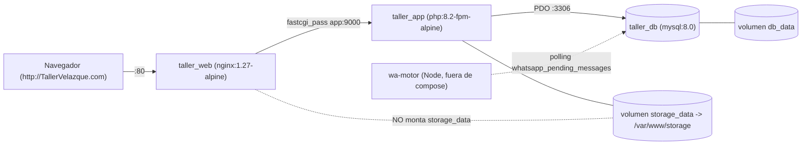

# 01 — Mapa del Proyecto y Arquitectura Base

> Proyecto: **Taller Velázquez (Capital Gestor)** · Auditoría: 2026-11-07
> Convenciones: **[HECHO]** verificado con `archivo:línea` · **[INFERENCIA]** deducción por convención · **[DUDA]** requiere validación del dueño · `❓ NO DETERMINABLE CON EL CÓDIGO`.

---

## 0. Advertencia de dominio (léase primero)

- **[HECHO]** El código fue construido originalmente para un POS de comida llamado **"El Bajón"** (hamburguesas, panadería, cemitas). Evidencias: valor por defecto `app_name = 'El bajón'` en `database/migrations/2026_10_16_000001_create_app_settings_table.php:14-26`, texto `HAMBURGUESAS & PANADERÍA` en `resources/views/layouts/guest.blade.php:280`, rol `cocina` en `database/seeders/RoleSeeder.php:16-19`, comando `pedidos:reenviar-cemitas-hoy` en `app/Console/Commands/ReenviarCemitasHoy.php:17`.
- **[HECHO]** No existen tablas de vehículos, órdenes de trabajo mecánicas, compatibilidad de refacciones ni mano de obra diferenciada. El dominio opera sobre entidades genéricas: `articulos`, `ventas`, `pedidos`, `entradas`, `comprobantes`, `pagos_vendedores` (ver `02-persistencia-y-contratos.md`).
- **[DUDA]** ¿El re-branding a "Taller Velázquez" implica nuevas entidades de taller (vehículo, orden de servicio) o se reutilizará el modelo genérico? `❓ NO DETERMINABLE CON EL CÓDIGO`.

---

## 1. Stack técnico verificado

| Componente | Versión / Valor | Evidencia |
|---|---|---|
| PHP (requisito) | `^8.2` | **[HECHO]** `composer.json:9` |
| PHP (contenedor) | `php:8.2-fpm-alpine` | **[HECHO]** `Dockerfile:4` |
| Laravel | `^12.0` (**no** Laravel 11 como indica el brief) | **[HECHO]** `composer.json:13` |
| Livewire | **No instalado** | **[HECHO]** ausente en `composer.json:8-36` y `package.json:9-24` |
| Frontend | Blade + Alpine.js `^3.4.2` + Tailwind `^3.1.0` / `@tailwindcss/vite ^4.0.0` + Vite `^7.0.4` | **[HECHO]** `package.json:11,12,18,19` |
| Base de datos | MySQL 8.0 | **[HECHO]** `docker-compose.yml:5-30` |
| Servidor web | `nginx:1.27-alpine` | **[HECHO]** `docker-compose.yml:65-78` |

### 1.1 Extensiones PHP del contenedor
- **[HECHO]** Paquetes de sistema: `libpng-dev`, `libjpeg-turbo-dev`, `freetype-dev`, `libzip-dev`, `oniguruma-dev`, `icu-dev`, `libxml2-dev`, `mysql-client` — `Dockerfile:7-22`.
- **[HECHO]** Extensiones: `pdo`, `pdo_mysql`, `mbstring`, `zip`, `gd`, `opcache`, `intl`, `bcmath`, `pcntl` — `Dockerfile:25-35`.
- **[HECHO]** **Faltan binarios usados por el código**: `tesseract` (invocado en `app/Services/ReceiptOcrService.php:172`) y `node` (invocado en `app/Http/Controllers/ConfiguracionController.php:134`) **no se instalan** en `Dockerfile:7-22`.

### 1.2 Dependencias clave (`composer.json`)

| Necesidad | Paquete | Evidencia |
|---|---|---|
| ORM | Eloquent (incluido en `laravel/framework`) | `composer.json:13` |
| PDFs | `barryvdh/laravel-dompdf ^3.1` | `composer.json:10` |
| OCR | `google/cloud-vision ^2.2` | `composer.json:11` |
| Web Push | `laravel-notification-channels/webpush ^11.0` | `composer.json:12` |
| WebSockets | `laravel/reverb ^1.0` | `composer.json:14` |
| Auth API | `laravel/sanctum ^4.0` | `composer.json:15` |
| Auth Web | `laravel/breeze ^2.3` (dev, scaffolding) | `composer.json:27` |
| QR | `simplesoftwareio/simple-qrcode ^4.2` | `composer.json:18` |
| DataTables | `yajra/laravel-datatables-oracle ^12.4` | `composer.json:23` |
| Mailers | `resend/resend-laravel`, `symfony/brevo-mailer`, `postmark-mailer`, `sendgrid-mailer` | `composer.json:17,19,21,22` |
| Testing | `pestphp/pest ^3.8`, `laravel/dusk ^8.6` | `composer.json:34,28` |
| Manipulación de imágenes | Solo extensión `gd`; sin Intervention Image | `Dockerfile:25-35` · `composer.json:8-36` |
| Colas | Driver de base de datos (tablas `jobs`, `failed_jobs`) | `database/migrations/0001_01_01_000002_create_jobs_table.php` |
| Cliente HTTP | `Http` facade de Laravel (ej. `routes/web.php:152-169` contra ntfy.sh) | `routes/web.php:152-169` |

---

## 2. Topología de ejecución (Docker)

| Servicio | Contenedor | Detalle | Evidencia |
|---|---|---|---|
| `db` | `taller_db` | `mysql:8.0`, utf8mb4, `mysql_native_password`, puerto `${DB_EXTERNAL_PORT:-3306}:3306`, volumen `db_data:/var/lib/mysql`, healthcheck `mysqladmin ping` | **[HECHO]** `docker-compose.yml:5-30` |
| `app` | `taller_app` | build `./Dockerfile`, `working_dir /var/www`, monta `.:/var/www` y `storage_data:/var/www/storage`, `APP_URL=${APP_URL:-http://TallerVelazque.com}`, depende de `db` healthy | **[HECHO]** `docker-compose.yml:34-61` (montajes L41-43, URL L49) |
| `web` | `taller_web` | `nginx:1.27-alpine`, `80:80`, monta `.:/var/www:ro` y `./docker/nginx.conf` | **[HECHO]** `docker-compose.yml:65-78` (montajes L72-73) |

### 2.1 Arranque del contenedor `app` (`docker/entrypoint.sh`)
1. **[HECHO]** Espera MySQL vía PDO — `docker/entrypoint.sh:23-43`.
2. **[HECHO]** Ajusta permisos de `storage` y `bootstrap/cache` — `docker/entrypoint.sh:49-50`.
3. **[HECHO]** `php artisan storage:link` — `docker/entrypoint.sh:54`.
4. **[HECHO]** `php artisan migrate --force` — `docker/entrypoint.sh:57`.
5. **[HECHO]** `php artisan optimize` — `docker/entrypoint.sh:60`.
6. **[HECHO]** Lanza `php-fpm` (puerto 9000) — `Dockerfile:85`, `docker/nginx.conf:36`.

### 2.2 Inconsistencias de topología
- **[HECHO]** `taller_web` no monta `storage_data` (`docker-compose.yml:72`) mientras que `taller_app` sí (`docker-compose.yml:43`): Nginx no ve los archivos subidos a `storage/app/public`.
- **[HECHO]** `public/storage` en el repo del host es un symlink absoluto a `/home/araiza/Proyectos/Capital_Gestor/storage/app/public`, ruta inexistente dentro de los contenedores.
- **[HECHO]** Archivos Docker huérfanos no referenciados en `docker-compose.yml`: `docker/php/Dockerfile`, `docker/nginx/default.conf`, `docker/wa-motor/Dockerfile`.
- **[DUDA]** El motor WhatsApp (`wa-motor/index.js`) no tiene servicio en `docker-compose.yml`; su forma de ejecución en producción es `❓ NO DETERMINABLE CON EL CÓDIGO`.

### 2.3 Scripts Windows
- **[HECHO]** `iniciar_windows.bat` y `detener_windows.bat` existen en la raíz para levantar/detener el stack con Docker Compose. Detalle en `.kiro/steering/tech.md`.

---

## 3. Puntos de entrada

### 3.1 Rutas Web (`routes/web.php`)

| Ruta | Controlador@método | Middleware | Evidencia |
|---|---|---|---|
| `GET /` | Closure (redirección por rol) | — | `routes/web.php:16` |
| `GET dashboardAdmin`, `GET admin/dashboard` | `DashboardController@indexAdmin` | `auth`, `role:admin` | `routes/web.php:26-29` |
| `GET /dashboard`, `/dashboard/vendedor` | `DashboardController@index` | `auth` | `routes/web.php:34-36` |
| `POST /pagos-vendedores` | `PagoVendedorController@store` | `auth` | `routes/web.php:38` |
| `GET/PATCH/DELETE /profile` | `ProfileController@edit/update/destroy` | `auth` | `routes/web.php:41-43` |
| `GET /user/{id}/image` | `ProfileController@showImage` | `auth` | `routes/web.php:44` |
| `GET catalogo`, `POST catalogo/vender` | `CatalogoController@index/vender` | `auth` | `routes/web.php:45-46` |
| `resource pedidos` | `PedidoController` | `auth` | `routes/web.php:47` |
| `POST ventas/multiples` | `VentaController@storeMultiple` | `auth` | `routes/web.php:48` |
| `POST ventas/{venta}/solicitar-anulacion` | `VentaController@solicitarAnulacion` | `auth` | `routes/web.php:49` |
| `resource ventas` | `VentaController` | `auth` | `routes/web.php:50` |
| `GET cobros` | `CobroController@index` | `auth` | `routes/web.php:52` |
| `feedback*` (5 rutas) | `FeedbackController` | `auth` | `routes/web.php:55-59` |
| `admin/clientes*` | `ClienteController` (+`activar`, `enviarWhatsAppAccess`) | `auth`, `role:admin` | `routes/web.php:69-71` |
| `admin/articulos*` | `ArticuloController` (+`resetStock`, `bulkDisponible`, `toggleDisponible`, `imagen`) | `auth`, `role:admin` | `routes/web.php:72-76` |
| `admin/entradas*` | `EntradaController` (+`reenviarWhatsApp`) | `auth`, `role:admin` | `routes/web.php:77-78` |
| `admin/pedidos*` | `PedidoController` (+`updateStatus`) | `auth`, `role:admin` | `routes/web.php:79-80` |
| `admin/configuracion*` | `ConfiguracionController` (logo, wa-status, wa-reset, wa-mark-*) | `auth`, `role:admin` | `routes/web.php:81-87` |
| `POST admin/enviar-masivo` | `DashboardController@enviarRecordatoriosMasivos` | `auth`, `role:admin` | `routes/web.php:88` |
| `POST admin/comprobantes/{id}/aprobar|rechazar` | `ComprobanteController` | `auth`, `role:admin` | `routes/web.php:91-92` |
| `admin/scoring/*` | `ClientScoringController` | `auth`, `role:admin` | `routes/web.php:95-96` |
| `GET admin/clientes/{cliente}/estado-cuenta/pdf` | `EstadoCuentaController@descargarPdfAdmin` | `auth`, `role:admin` | `routes/web.php:99` |
| `admin/pagos-vendedores*` | `PagoVendedorController@index/updateRetencion` | `auth`, `role:admin` | `routes/web.php:102-103` |
| `admin/personalizacion*` | `BrandingController@index/update/reset` | `auth`, `role:admin` | `routes/web.php:106-108` |
| `POST comprobantes` | `ComprobanteController@store` | `auth` | `routes/web.php:113` |
| `GET estado-cuenta/pdf` | `EstadoCuentaController@descargarPdfCliente` | `auth` | `routes/web.php:116` |
| `push/*`, `notifications/*` | `PushSubscriptionController` | `auth` | `routes/web.php:121-124` |
| `manual-usuario`, `tutorial/marcar-visto` | `TutorialController` | `auth` | `routes/web.php:129-130` |
| `mi-tema*` | `UserThemeController` | `auth` | `routes/web.php:135-137` |
| ⚠️ `GET /descargar-log-secreto` | Closure (descarga `laravel.log`) | **ninguno** | `routes/web.php:142-150` |
| ⚠️ `GET /enviar-alerta`, `GET /test-notif` | Closures (POST a ntfy.sh) | **ninguno** | `routes/web.php:152-169` |

Autenticación Breeze: `routes/auth.php:14-60` (login, register, forgot/reset password, verify-email, confirm-password, logout).

### 3.2 Rutas API (`routes/api.php`, prefijo `/api`)
- **[HECHO]** `POST /login` con `throttle:6,1` — `routes/api.php:16`.
- **[HECHO]** Grupo `auth:sanctum` — `routes/api.php:20-51`: `profile` (L22-24), `dashboard` (L26), `catalogo` + `catalogo/vender` (L27-28), `apiResource entradas` (L29), `clientes` (L30-33), `apiResource pedidos/ventas` (L35-36), sub-grupo `role:admin` con prefijo `admin` (L38-46), `POST /logout` (L51).
- Detalle de contratos en `.kiro/steering/api-contract.md`.

### 3.3 Comandos de consola (`app/Console/Commands/*`)

| `$signature` | Archivo |
|---|---|
| `db:backup {--days=7}` | `app/Console/Commands/BackupDatabase.php:15` |
| `whatsapp:recordatorios` | `app/Console/Commands/EnviarRecordatoriosMasivos.php:14` |
| `db:fix-sequences` (PostgreSQL) | `app/Console/Commands/FixPostgresSequences.php:16` |
| `storage:migrate-base64 ...` | `app/Console/Commands/MigrateBase64Storage.php:21` |
| `pedidos:reenviar-cemitas-hoy {--phone=}` | `app/Console/Commands/ReenviarCemitasHoy.php:17` |
| `comprobantes:reprocesar-ocr {--id=} {--all}` | `app/Console/Commands/ReprocesarComprobantesOcr.php:19` |
| `articulos:reset-disponibilidad` | `app/Console/Commands/ResetArticulosDisponibilidad.php:15` |
| `wa:send {numero} {mensaje}` | `app/Console/Commands/SendWhatsAppAutomation.php:15` |

Programación (scheduler): `routes/console.php:7-41`.

---

## 4. `AppServiceProvider` — inyección global y bloques de mantenimiento

Archivo: `app/Providers/AppServiceProvider.php`

1. **[HECHO]** `URL::forceScheme('https')` cuando `config('app.env') === 'production'` — `AppServiceProvider.php:29-31`. Ver riesgo en §4 de `03-flujos-negocio.md`.
2. **[HECHO]** `View::composer('*', ...)` inyecta el `AppSetting` (nombre, logo, favicon, colores, fuente, modo de tema) en **todas** las vistas — `AppServiceProvider.php:34-41`.
3. ⚠️ **[HECHO]** Comando secreto: `if (!app()->runningInConsole() && request()->has('comando_secreto'))` ejecuta `config:clear`, `cache:clear`, `route:clear`, `view:clear`, `migrate --force`, `storage:link` y termina con `die(...)`, **sin autenticación**, en cualquier URL — `AppServiceProvider.php:43-63`. Registrado como `DT-01`.

---

## 5. Top 15 archivos corazón del sistema

| # | Archivo | Justificación |
|---|---|---|
| 1 | `app/Providers/AppServiceProvider.php:24-63` | Branding global, forzado HTTPS y backdoor `comando_secreto`. |
| 2 | `routes/web.php:16-169` | Mapa completo de pantallas y endpoints de depuración expuestos. |
| 3 | `app/Http/Controllers/VentaController.php:92-273` | Venta multi-artículo con `lockForUpdate()` y descuento de stock. |
| 4 | `app/Http/Controllers/PedidoController.php:76-313` | Pedidos que generan ventas y notificaciones WhatsApp. |
| 5 | `app/Http/Controllers/ComprobanteController.php:20-234` | Subida de comprobante → OCR → aprobación → `Entrada` + PDF. |
| 6 | `app/Http/Controllers/PagoVendedorController.php:179-284` | Liquidación/nómina de vendedores con retención. |
| 7 | `app/Models/User.php:108-321` | Roles (`roles()`, `hasRole()`) y cálculo de saldos (`scopeWithSaldos`). |
| 8 | `app/Http/Middleware/RoleMiddleware.php:17-25` | Autorización por rol en rutas. |
| 9 | `app/Http/Controllers/Auth/AuthenticatedSessionController.php:25-62` | Login web y redirección por rol. |
| 10 | `app/Http/Controllers/BrandingController.php:20-169` | Personalización de marca (logo, favicon, colores). |
| 11 | `app/Http/Controllers/ConfiguracionController.php:24-280` | Logo + control del motor WhatsApp (estado, reset, cola). |
| 12 | `wa-motor/index.js:617-732` | Daemon Node que consume `whatsapp_pending_messages`. |
| 13 | `app/Services/ReceiptOcrService.php:12-637` | OCR Tesseract + Google Vision para comprobantes bancarios. |
| 14 | `app/Services/PdfReceiptService.php:9-244` | Generación de recibos/estados de cuenta PDF. |
| 15 | `docker-compose.yml:1-93` | Topología de contenedores, volúmenes y variables de entorno. |
