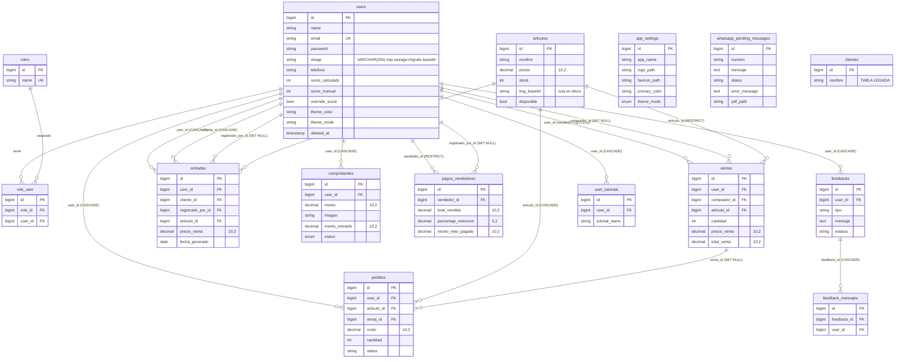

# 02 — Modelo de Datos, Persistencia e Integraciones Externas

> Convenciones: **[HECHO]** · **[INFERENCIA]** · **[DUDA]** · `❓ NO DETERMINABLE CON EL CÓDIGO`.
> Fuente: 41 migraciones en `database/migrations/`, 4 seeders en `database/seeders/`, 13 modelos en `app/Models/`.

---

## 1. Diagrama Entidad-Relación (tablas de dominio)

> `whatsapp_pending_messages`, `app_settings` y `clientes` no tienen FK hacia otras tablas.

---

## 2. Catálogo de tablas

### 2.1 `users`
| Columna | Tipo | Evidencia |
|---|---|---|
| `id, name, email (unique), email_verified_at, password, remember_token, timestamps` | Breeze base | `0001_01_01_000000_create_users_table.php:14-22` |
| `image` | `longText` → `VARCHAR(255)` | `2026_01_27_171635_add_image_to_users_table.php:16`; `app/Console/Commands/MigrateBase64Storage.php:391` |
| `image_tipo` | `longText` → `VARCHAR(50)` | `2026_01_27_172854_add_tipo_to_users_table.php:16`; `MigrateBase64Storage.php:391` |
| `telefono` | `string nullable` | `2026_04_27_095828_add_telefono_to_users_table.php:16` |
| `deleted_at` | `softDeletes` | `2026_08_05_122131_add_deleted_at_to_users_table.php:15` |
| `score_calculado` (int def. 70), `score_manual`, `override_score`, `notas_scoring` | scoring | `2026_09_02_210000_add_scoring_fields_to_users_table.php:14-19` |
| `theme_color varchar(7)`, `theme_mode varchar(10) def 'system'` | tema | `2026_10_19_000001_add_theme_preferences_to_users_table.php:14-17` |

- **[HECHO]** Modelo `User` usa `SoftDeletes`, `HasApiTokens`, `HasPushSubscriptions` (`app/Models/User.php:23`).

### 2.2 `roles` / `role_user`
- **[HECHO]** `roles(id, name unique, timestamps)` — `2025_08_12_173449_create_roles_table.php:14-18`.
- **[HECHO]** `role_user(id, role_id FK cascade, user_id FK cascade, timestamps)` — `2025_08_12_180515_create_role_user_table.php:14-19`. **Sin índice único** `(user_id, role_id)`.
- **[HECHO]** Roles sembrados: `admin`, `vendedor`, `cocina`, `cliente` (`database/seeders/RoleSeeder.php:16-19`). La migración `2026_10_15_000004_create_pagos_vendedores_table.php:19-52` también los inserta y migra el rol legado `user` → `cliente`.

### 2.3 `articulos`
| Columna | Tipo | Evidencia |
|---|---|---|
| `nombre` | string | `2025_08_12_222329_create_articulos_table.php:16` |
| `descripcion` | text nullable | `…:17` |
| `precio` | **`decimal(10,2)`** | `…:18` |
| `stock` | integer default 0 | `…:19` |
| `img_base64` | `longText` → `VARCHAR(255)` (ruta) | `2025_08_15_165727_agregar_campos_a_articulos.php:15`; `MigrateBase64Storage.php:394` |
| `imagen_tipo` | string → `VARCHAR(50)` | `2025_08_15_165727_agregar_campos_a_articulos.php:16` |
| `disponible` | boolean | `2026_08_05_102948_add_disponible_to_articulos_table.php` |
| Índices | `articulos_nombre_index`, `articulos_disponible_index` | `2026_09_24_100409_add_performance_indexes_to_articulos_table.php:21,24` |

- **[HECHO]** `Articulo::$fillable` incluye `img_tipo` (`app/Models/Articulo.php:22`), columna que **no existe** en ninguna migración.

### 2.4 `ventas`
| Columna | Tipo / FK | Evidencia |
|---|---|---|
| `user_id` | FK `users`, onDelete por defecto (RESTRICT) | `2025_08_12_230600_create_ventas_table.php:16` |
| `articulo_id` | FK `articulos` (RESTRICT) | `…:17` |
| `precio_venta`, `total_venta` | **`decimal(10,2)`** | `…:18-19` |
| `cantidad` | int default 1 | `2026_08_01_184000_add_cantidad_to_ventas_table.php` |
| `comprador_id` | FK `users` **SET NULL** | `2026_10_15_000003_add_audit_users_to_ventas_and_entradas_tables.php:19-23` |
| Índices | `ventas_created_at_index`; compuesto `(user_id, created_at, total_venta)` | `2026_09_24_100409…:31`; `2026_10_15_000002…:27` |

- **[HECHO]** `Venta::$fillable` incluye `cliente_id` (`app/Models/Venta.php:17`), columna inexistente en `ventas`.
- **[HECHO]** `Venta::cliente()` hace `belongsTo(Cliente::class)->withTrashed()` (`app/Models/Venta.php:39-42`), pero `Cliente` **no** usa `SoftDeletes` (`app/Models/Cliente.php`) → `BadMethodCallException` si se invoca.
- **[INFERENCIA]** `comprador_id` tiene índice implícito por su FK en MySQL/InnoDB, pero no índice compuesto con `created_at` pese a filtrarse por comprador y fecha en reportes.

### 2.5 `pedidos`
- **[HECHO]** `user_id` FK cascade, `articulo_id` FK cascade, `descripcion` string, `costo decimal(10,2)`, `venta_id` FK **SET NULL**, índices `user_id` y `created_at` — `2025_09_02_183222_create_pedidos_table.php:16-23`.
- **[HECHO]** `cantidad` int default 1 — `2026_08_01_184200_add_cantidad_to_pedidos_table.php`; `status string(50) default 'en_preparacion'` + índice — `2026_09_02_194200_add_status_to_pedidos_table.php:16-17`.

### 2.6 `entradas` (abonos/pagos de clientes)
- **[HECHO]** `user_id` FK cascade, `cliente_id` FK `users` nullable cascade, `articulo_id` FK, `precio_venta decimal(10,2)`, `descripcion`, `fecha_generado date` — `2025_08_13_191738_create_entradas_table.php:16-21`. FK de `cliente_id` reajustada en `2026_08_01_202500`, `2026_08_03_161500`, `2026_08_04_170000…:17-27`.
- **[HECHO]** `registrado_por_id` FK `users` SET NULL, backfill `COALESCE(cliente_id, user_id, 1)` — `2026_10_15_000003…:33-43`.
- **[HECHO]** Índices `fecha_generado`, `created_at` (`2026_09_24_100409…:38-42`) y compuesto `(cliente_id, created_at, precio_venta)` (`2026_10_15_000002…:40`).
- **[HECHO]** `User::scopeWithSaldos` suma `entradas` vía `User::entradas()` = `hasMany(Entrada::class)` (clave `user_id`) — `app/Models/User.php:114-117,154-164`; el índice compuesto empieza por `cliente_id`, por lo que no cubre esa agregación.
- **[DUDA]** Semántica de `user_id` vs `cliente_id` en `entradas`: ¿quién es el cliente que abona? Los modelos usan ambos (`app/Models/Entrada.php:23-31`).

### 2.7 `comprobantes`
- **[HECHO]** `user_id` FK cascade, `monto decimal(10,2) nullable`, `imagen string`, `status enum`, `notas` — `2026_08_05_180330_create_comprobantes_table.php:16-20`.
- **[HECHO]** `banco`, `clave_rastreo`, `fecha_transferencia` (string), `clabe_cuenta`, `monto_extraido decimal(10,2)`, `datos_ocr_json text`; enum ampliado a `procesando_pago|pendiente|aprobado|rechazado` vía `DB::statement` solo-MySQL — `2026_09_02_200000_add_ocr_fields_to_comprobantes_table.php:16-27`.
- **[HECHO]** No hay índice sobre `status` ni `clave_rastreo` (posible detección de duplicados).

### 2.8 `pagos_vendedores` (nómina/liquidación)
- **[HECHO]** `vendedor_id` FK RESTRICT, `registrado_por_id` FK SET NULL, `total_vendido`, `monto_retenido`, `monto_neto_pagado` `decimal(10,2)`, `porcentaje_retencion decimal(5,2) default 20.00`, `metodo_pago string(50) default 'efectivo'`, índice `(vendedor_id, created_at)` — `2026_10_15_000004_create_pagos_vendedores_table.php:58-76`.

### 2.9 `app_settings`
- **[HECHO]** `app_name default 'El bajón'`, `logo_path`, `favicon_path`, `primary_color #6366f1`, `secondary_color #10b981`, `sidebar_color #0f172a`, `font_family 'Inter'`, `theme_mode enum(light,dark,system) default 'light'` — `2026_10_16_000001_create_app_settings_table.php:16-23`.

### 2.10 `whatsapp_pending_messages`
- **[HECHO]** `numero string`, `mensaje text`, `status string default 'pendiente'` (comentario: `pendiente, enviado, error`) — `2026_05_29_125352_create_whatsapp_pending_messages_table.php:16-18`; `error_message` (`2026_06_30_172430…`), `pdf_path` (`2026_08_28_204500…`).
- **[HECHO]** **Sin modelo Eloquent**: se usa `DB::table('whatsapp_pending_messages')` (ej. `app/Http/Controllers/PedidoController.php:203`).
- **[HECHO]** **Sin índice** sobre `status`/`created_at`, aunque `wa-motor/index.js:625` consulta `WHERE status = 'pendiente' ORDER BY created_at ASC LIMIT 5` cada 5 s (`wa-motor/index.js:618,732`).
- **[HECHO]** Estados realmente escritos: `pendiente`, `enviado` (`wa-motor/index.js:696`), `fallido` (`wa-motor/index.js:650,717`), `cancelado` (`app/Services/NotificationCircuitBreakerService.php:66`). El comentario de la migración (`error`) no coincide.

### 2.11 Otras
- `feedbacks`, `feedback_mensajes` — `2026_08_04_180000_create_feedbacks_table.php`.
- `user_tutorials` (único `user_id, tutorial_name`) — `2026_09_03_131317_create_user_tutorials_table.php`.
- `clientes` (**legada**): `2025_08_13_173750_create_clientes_table.php`; `2025_08_13_174636_add_telefono_to_clientes_table.php` no altera columnas. Aun así, `Api\CatalogoApiController` valida `'cliente_id' => 'required|exists:clientes,id'` (`app/Http/Controllers/Api/CatalogoApiController.php:51`).
- Infraestructura: `cache`, `jobs`, `failed_jobs`, `sessions`, `password_reset_tokens`, `personal_access_tokens`, `notifications`, `push_subscriptions`.

### 2.12 Campos monetarios
- **[HECHO]** Todos los importes usan `decimal(10,2)` (`articulos.precio`, `ventas.*`, `pedidos.costo`, `entradas.precio_venta`, `comprobantes.monto*`, `pagos_vendedores.*`). No se detectaron `float` ni enteros para dinero en migraciones.
- **[HECHO]** En PHP se convierten a `float` para cálculos (ej. `app/Http/Controllers/VentaController.php:129`, `app/Models/User.php:169-240`) → riesgo de redondeo binario.

---

## 3. Seeders
- **[HECHO]** `DatabaseSeeder` llama `RoleSeeder`, `UsuariosSeeder`, `AppSettingSeeder` y crea artículos con `firstOrCreate` — `database/seeders/DatabaseSeeder.php:18-26`.
- **[HECHO]** `UsuariosSeeder` crea `root` + 25 nombres reales con `email` aleatorio de Faker (`database/seeders/UsuariosSeeder.php:53`) y contraseña `Hash::make(($index % 8) + 1)` — es decir, contraseñas de un dígito (`UsuariosSeeder.php:54`). Asigna rol por **ID fijo**: `attach(1)` a `root`, `attach(2)` al resto (`UsuariosSeeder.php:56-60`).
- **[INFERENCIA]** Como el email de `root` es aleatorio y el login exige formato email (`app/Http/Controllers/Auth/AuthenticatedSessionController.php:27-30`), nadie conoce de antemano el usuario administrador tras sembrar.

---

## 4. Mecanismo de roles y permisos
1. **[HECHO]** `User::roles()` → `belongsToMany(Role::class)->withPivot('user_id','role_id')` — `app/Models/User.php:108-112`.
2. **[HECHO]** `User::hasRole($roleName)` itera `$this->roles` y trata `cliente` y `user` como alias — `app/Models/User.php:310-321`.
3. **[HECHO]** `RoleMiddleware::handle($request, $next, string $role)` → `abort(403)` si no autenticado o sin rol — `app/Http/Middleware/RoleMiddleware.php:17-25`; alias `role` en `bootstrap/app.php:22-24`.
4. **[HECHO]** Asignación con `attach()` en seeders (`UsuariosSeeder.php:57-59`). No hay Policies ni Gates registradas (`❓ NO DETERMINABLE CON EL CÓDIGO` si existen fuera de `app/Policies`; la carpeta no está presente).
5. **[HECHO]** Solo el rol `admin` se usa en middleware de rutas (`routes/web.php:26,61`; `routes/api.php:38`). `vendedor`, `cocina` y `cliente` se distinguen dentro de controladores/vistas.
6. **[INFERENCIA]** `hasRole()` dispara una consulta por petición si `roles` no está precargado (N+1 en listados que la llaman por usuario).

---

## 5. Integraciones externas

### 5.1 Motor de WhatsApp (`wa-motor/`)
- **[HECHO]** Node.js con `whatsapp-web.js ^1.34.7`, `puppeteer ^22.12.0`, `mysql2`, `pg`, `qrcode` (`wa-motor/package.json`).
- **[HECHO]** Selecciona MySQL o PostgreSQL según `DB_CONNECTION` (`wa-motor/index.js:16,72-91`); adapta placeholders `$n` → `?` para MySQL (`wa-motor/index.js:99`).
- **[HECHO]** Bucle `setInterval` cada 5000 ms con candado `isProcessing` (`wa-motor/index.js:618-732`): lee 5 pendientes (L625), envía texto y, si hay `pdf_path`, adjunta `MessageMedia` (L650-717), marca `enviado`/`fallido`.
- **[HECHO]** Escribe el QR en una ruta absoluta de la máquina del desarrollador (`wa-motor/index.js:371,404`).
- **[HECHO]** Credenciales PostgreSQL de respaldo **hardcodeadas** en `getPgPoolConfig()` (`wa-motor/index.js:44,49`). Valor omitido en esta documentación.
- **[HECHO]** Laravel arranca/reinicia el proceso con `shell_exec`/`exec` (`pgrep`, `pm2`, `pkill`, `nohup node`) — `app/Http/Controllers/ConfiguracionController.php:131-134,176,219-220`.
- **[HECHO]** Productores de la cola: `PedidoController.php:203,240,268,285,461,469,489`, `ClienteController.php` (credenciales), `Venta::notificarAdminWhatsApp` (`app/Models/Venta.php:52`), `Feedback::notificarAdminWhatsApp` (`app/Models/Feedback.php:66`), `PagoVendedorController::notificarLiquidacionWhatsApp` (`app/Http/Controllers/PagoVendedorController.php:230`), comandos `whatsapp:recordatorios` y `wa:send`.
- **[HECHO]** `NotificationCircuitBreakerService` cancela mensajes duplicados (`status = 'cancelado'`) — `app/Services/NotificationCircuitBreakerService.php:52-66`.

### 5.2 OCR de comprobantes
- **[HECHO]** `ReceiptOcrService::processImage()` invocado en `app/Http/Controllers/ComprobanteController.php:33`; usa binario `tesseract` (`app/Services/ReceiptOcrService.php:172`) y `google/cloud-vision`. Credenciales de Google: `❓ NO DETERMINABLE CON EL CÓDIGO` (no hay variable en `.env.example`).

### 5.3 PDFs
- **[HECHO]** `PdfReceiptService` (DomPDF) genera recibos y estados de cuenta (`app/Services/PdfReceiptService.php`); se usa tras aprobar comprobantes (`app/Http/Controllers/ComprobanteController.php:196`).

### 5.4 Web Push / Broadcast / ntfy
- **[HECHO]** `PushNotificationService` + `push_subscriptions` + rutas `push/*` (`routes/web.php:121-124`), recordatorios programados (`routes/console.php:25-35`).
- **[HECHO]** `ntfy.sh` solo en ruta de prueba pública (`routes/web.php:159-169`).

### 5.5 Sistema de archivos
| Uso | Disco / carpeta | Evidencia |
|---|---|---|
| Logo/Favicon (branding) | `public` → `branding/` | `app/Http/Controllers/BrandingController.php:101,110` |
| Logo (configuración) | `public` → `branding/` **y copia a `public/img/Logo.svg|png`** | `app/Http/Controllers/ConfiguracionController.php:46,59,61` |
| Comprobantes | `public` → `comprobantes/` | `app/Http/Controllers/ComprobanteController.php:29` |
| Avatares | `public` → `avatars/` | `app/Http/Controllers/ClienteController.php:70,126` |
| Feedback | **`public/uploads/feedbacks/`** (fuera de `storage`, vía `$file->move(public_path(...))`, nombre aleatorio) | `app/Http/Controllers/FeedbackController.php:86-92` |
| PDFs temporales | `storage/app/temp_pdfs` | `docker/php/Dockerfile:56` |

- **[HECHO]** Los comprobantes bancarios (datos financieros personales) se guardan en el disco **público**, accesibles por URL directa sin autenticación si se conoce el nombre (`ComprobanteController.php:29`, `config/filesystems.php:41-47`).
