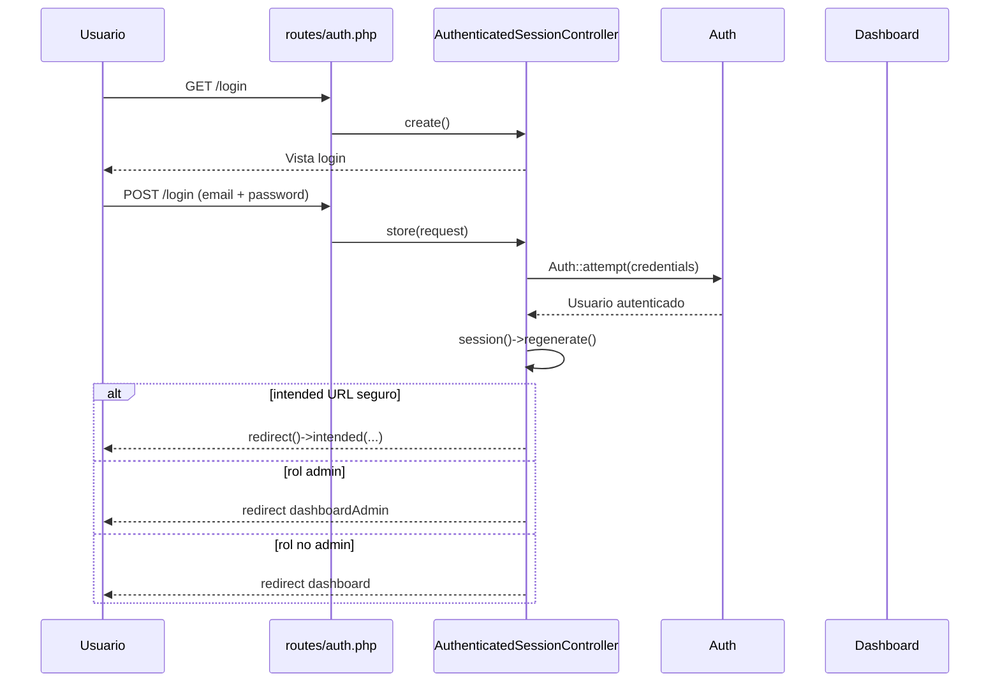
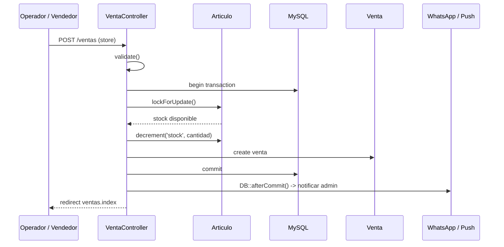
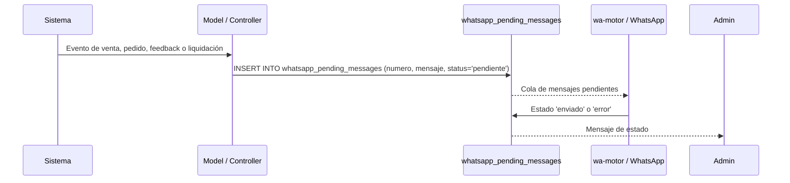
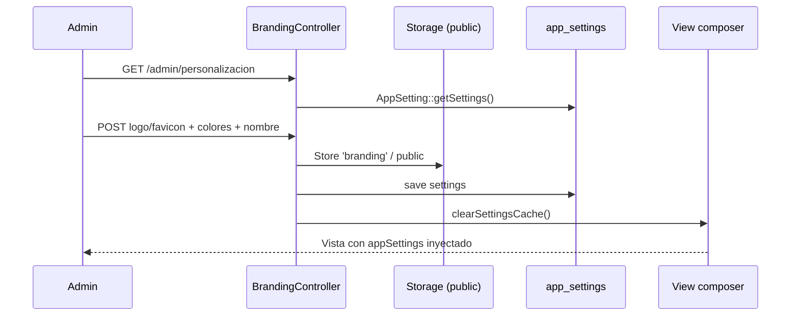

# 03 - Flujos de Negocio Principales

## 1) Flujo de autenticación y autorización

### Evidencias de código

- `routes/auth.php:12-61` registra `login`, `register`, `logout` y `password.*`.
- `app/Http/Controllers/Auth/AuthenticatedSessionController.php:15-58` valida credenciales, autentica y redirige según `hasRole('admin')`.
- `app/Models/User.php:310-322` implementa la validación de rol como `hasRole(string $roleName): bool`.
- `app/Http/Middleware/RoleMiddleware.php:15-24` aborta con 403 si un usuario no tiene el rol requerido.

### Redirección por rol

- `app/Http/Controllers/Auth/AuthenticatedSessionController.php:39-57` redirige a `dashboardAdmin` para administradores y a `dashboard` para el resto.
- `routes/web.php:26-46` registra `dashboardAdmin` y `dashboard` bajo middleware `auth`.
- `app/Http/Controllers/DashboardController.php:24-44` condicionalmente renderiza admin o dashboards de usuarios según `hasRole('admin')`/`hasRole('vendedor')`/`hasRole('cliente')`.

## 2) Flujo de punto de venta y liquidación

### Evidencias de código

- `app/Http/Controllers/VentaController.php:85-165` valida `articulo_id`, `cantidad`, `cliente_id`, `precio_venta` y usa `DB::transaction()`.
- `app/Http/Controllers/VentaController.php:90-112` aplica bloqueo pesimista con `Articulo::lockForUpdate()` y valida stock real.
- `app/Http/Controllers/VentaController.php:118-148` decremente stock y crea la instancia de `Venta`.
- `app/Models/Venta.php:60-115` genera el mensaje de WhatsApp y lo encola en `whatsapp_pending_messages`.
- `database/migrations/2025_08_12_230600_create_ventas_table.php:8-26` fija las columnas monetarias y la estructura principal de la venta.

## 3) Flujo de notificaciones de servicio (WhatsApp)

### Evidencias de código

- `database/migrations/2026_05_29_125352_create_whatsapp_pending_messages_table.php:8-28` crea la cola.
- `app/Models/Venta.php:60-115` inserta `status => 'pendiente'` para notificaciones de administración.
- `app/Http/Controllers/PedidoController.php` y `app/Http/Controllers/EntradaController.php` insertan mensajes pendientes para diversos eventos del negocio.
- `app/Http/Controllers/ConfiguracionController.php:11-31` y `:82-118` muestran mensajes pendientes y permiten consultar el estado del motor.
- `docker-compose.yml:64-88` expone el contenedor `wa-motor` con sesion persistente `.wwebjs_auth`.

## 4) Flujo de personalización y marca

### Evidencias de código

- `app/Http/Controllers/BrandingController.php:14-168` valida `app_name`, colores, fuentes, logo y favicon; guarda en storage con `store('branding', 'public')`.
- `app/Models/AppSetting.php:11-118` centraliza la configuración y guarda datos en cache con `Cache::rememberForever`.
- `app/Providers/AppServiceProvider.php:24-41` inyecta `appSettings` en todas las vistas usando `View::composer('*', ...)`.
- `app/Http/Controllers/ConfiguracionController.php:35-77` actualiza el logo y crea copias de compatibilidad en `public/img`.

## 5) Implicaciones operativas

- El flujo de venta tiene validación de stock real y transacción de base de datos; la notificación externa se desacopla con `DB::afterCommit()` para no bloquear la operación si WhatsApp falla. `app/Http/Controllers/VentaController.php:117-165`.
- La cola de teléfono está centralizada en `whatsapp_pending_messages`, pero la entrega real al usuario/administrador depende de la operación del motor Node. `docker-compose.yml:64-88` y `database/migrations/2026_05_29_125352_create_whatsapp_pending_messages_table.php:8-28`.
- La mejora principal del módulo se vuelve clara al observar la personalización visual centralizada en `AppSetting` y su inyección global en vistas: no se requiere cambiar cada blade para reflejar el tema del taller.
