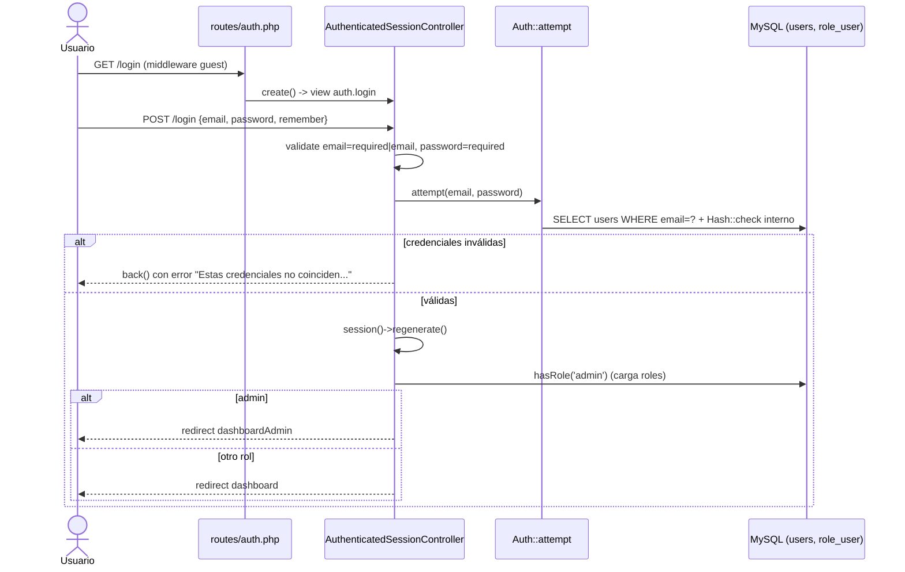
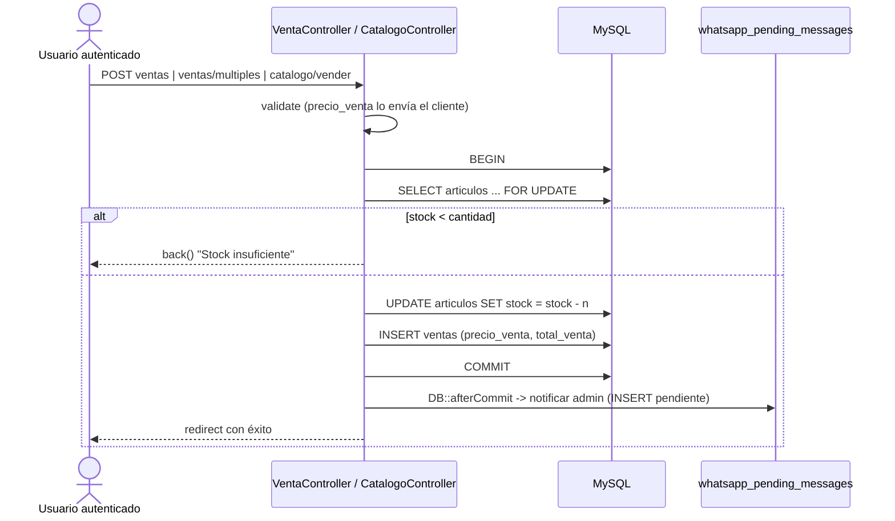
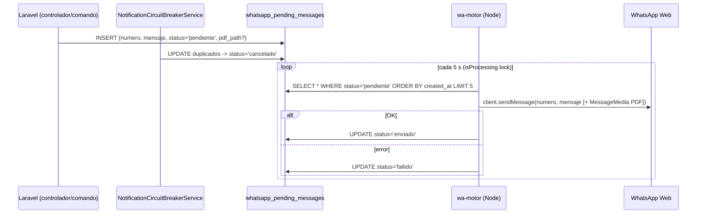

# 03 — Flujos End-to-End Principales

> Convenciones: **[HECHO]** · **[INFERENCIA]** · **[DUDA]** · `❓ NO DETERMINABLE CON EL CÓDIGO`.

---

## 1. Autenticación y autorización

### 1.1 Web (sesión)



- **[HECHO]** `GET login` → `AuthenticatedSessionController@create` (`routes/auth.php:20`, `app/Http/Controllers/Auth/AuthenticatedSessionController.php:17-20`).
- **[HECHO]** `store()` valida inline `email|required|email` y `password|required` (`AuthenticatedSessionController.php:27-30`) e **ignora** `App\Http\Requests\Auth\LoginRequest` (que incluye rate limiting de Breeze). → **No hay throttling en login web**.
- **[HECHO]** Solo se acepta **email**; el campo del formulario es `type="email"` (`resources/views/auth/login.blade.php:53`). No existe login por nombre `root`.
- **[HECHO]** Limpia `url.intended` si contiene `wa-status`, `api` o `json` (`AuthenticatedSessionController.php:47-51`) y redirige por rol (`L53-61`).
- **[HECHO]** La raíz `/` y `redirectUsersTo` también redirigen por rol (`routes/web.php:16-24`, `bootstrap/app.php:38-43`).

### 1.2 API (Sanctum)
- **[HECHO]** `POST /api/login` con `throttle:6,1` (`routes/api.php:16`) → `Api\AuthController@login`: busca por email y verifica `Hash::check($request->password, $user->password)` (`app/Http/Controllers/Api/AuthController.php:19-21`), luego consulta roles vía `role_user` (`L27`) y emite token Sanctum. Formato exacto de respuesta en `.kiro/steering/api-contract.md`.
- **[HECHO]** Tokens expirados se purgan con `sanctum:prune-expired --hours=2` diario (`routes/console.php:11`).

### 1.3 HTTP vs HTTPS
- **[HECHO]** `URL::forceScheme('https')` solo si `APP_ENV=production` (`app/Providers/AppServiceProvider.php:29-31`), **independiente de `APP_URL`**.
- **[HECHO]** Docker local usa `APP_ENV=${APP_ENV:-local}` y `APP_URL=${APP_URL:-http://localhost:8080}` (`docker-compose.yml:34,36`) y Nginx solo escucha en 80 (`docker/nginx/default.conf:2`) → en local se generan URLs `http`. 
- **[INFERENCIA]** Si alguien pone `APP_ENV=production` en un entorno sin TLS, todas las URLs generadas (`route()`, `asset()`) serán `https://` y fallarán; `trustProxies(at: '*')` (`bootstrap/app.php:27`) confía en cualquier `X-Forwarded-Proto`.

---

## 2. Punto de venta y liquidación

### 2.1 Venta (catálogo / ventas)



- **[HECHO]** `VentaController@store`: `DB::transaction` + `Articulo::lockForUpdate()` + validación de stock + `decrement('stock')` + `DB::afterCommit` para WhatsApp (`app/Http/Controllers/VentaController.php:103-152`).
- **[HECHO]** `storeMultiple` (carrito) replica el patrón por artículo (`VentaController.php:189-246`); `update` devuelve stock al artículo anterior (`VentaController.php:340-345`).
- **[HECHO]** `CatalogoController@vender`: transacción + `lockForUpdate()` + `decrement` (`app/Http/Controllers/CatalogoController.php:58-76`).
- ⚠️ **[HECHO]** El **precio unitario lo envía el cliente**: `precio_venta => required|numeric|min:0` y se persiste tal cual (`CatalogoController.php:53,79-84`; `VentaController.php:98,129-135`; `Api/CatalogoApiController.php:52,75-76`). En cambio `Api/VentaApiController` sí usa `$articulo->precio` (`app/Http/Controllers/Api/VentaApiController.php:77-83`).
- **[INFERENCIA]** Cualquier usuario autenticado (incluido rol `cliente`) puede registrar una venta con precio 0 en `POST catalogo/vender` (`routes/web.php:46`, solo `auth`).

### 2.2 Pedidos

- **[HECHO]** `PedidoController@store` crea `Venta::create([...])` (`app/Http/Controllers/PedidoController.php:136`) y encola mensajes a admins y rol `cocina` (`PedidoController.php:100-111,203-285`).
- ⚠️ **[HECHO]** `PedidoController@store` **no** usa `DB::transaction` ni descuenta `articulos.stock` (no hay `decrement` ni `lockForUpdate` en el archivo) — inconsistente con `VentaController`.
- **[HECHO]** Estados de pedido: columna `status` default `en_preparacion` (`2026_09_02_194200_add_status_to_pedidos_table.php:16`); cambio vía `POST admin/pedidos/{id}/status` → `updateStatus` (`routes/web.php:80`, `PedidoController.php:528`). Catálogo completo de estados: `❓ NO DETERMINABLE CON EL CÓDIGO` (sin enum).

### 2.3 Cobro: comprobante → OCR → entrada → PDF

```mermaid
sequenceDiagram
    actor C as Cliente
    actor A as Admin
    participant CC as ComprobanteController
    participant OCR as ReceiptOcrService
    participant DB as MySQL
    participant PDF as PdfReceiptService
    participant WA as whatsapp_pending_messages
    C->>CC: POST /comprobantes (imagen <= 5MB, jpeg/png/jpg/webp)
    CC->>CC: store('comprobantes','public')
    CC->>OCR: processImage(fullPath) + compareAmounts
    CC->>DB: INSERT comprobantes status=procesando_pago
    CC->>WA: aviso a admins
    A->>CC: POST admin/comprobantes/{id}/aprobar
    CC->>DB: busca articulo nombre LIKE '%pago saldado%'
    CC->>DB: BEGIN; INSERT entradas; UPDATE comprobante=aprobado; COMMIT
    CC->>PDF: afterCommit -> generateEntradaPdf(entrada)
    CC->>WA: INSERT mensaje + pdf_path
```

- **[HECHO]** Validación de imagen (`app/Http/Controllers/ComprobanteController.php:24`), guardado (`L29`), OCR (`L33-38`), `status = procesando_pago` (`L85`), aviso a admins (`L95-108`).
- **[HECHO]** `aprobar()` localiza un artículo "comodín" por nombre `LIKE '%pago saldado%'` (`ComprobanteController.php:161-162`), crea `Entrada` en transacción (`L166-178`) y genera PDF tras commit (`L180-196`).
- **[INFERENCIA]** Si el artículo "pago saldado" no existe, `articulo_id` será `null` y el `INSERT` fallará porque `entradas.articulo_id` no es nullable (`2025_08_13_191738_create_entradas_table.php:18`).
- **[HECHO]** `rechazar()` solo cambia estado (`ComprobanteController.php:239-247`).

### 2.4 Liquidación de vendedores (nómina)
- **[HECHO]** `PagoVendedorController@store` (`app/Http/Controllers/PagoVendedorController.php:179-228`): transacción (`L197`), crea `PagoVendedor` y notifica por WhatsApp tras commit (`L214`, `notificarLiquidacionWhatsApp` en `L230`). Porcentaje configurable (`getRetencionConfig` L24, `getPorcentajeRetencion` L46, `updateRetencion` L139).
- **[HECHO]** La ruta `POST /pagos-vendedores` solo exige `auth` (`routes/web.php:38`), pero `store()` verifica `hasRole('admin')` y aborta con 403 (`PagoVendedorController.php:182-184`). El servidor recalcula `monto_retenido = round(total * %/100, 2)` (`PagoVendedorController.php:198-200`).

### 2.5 Ticket / comprobante de venta
- **[HECHO]** Estados de cuenta PDF: `EstadoCuentaController@descargarPdfCliente|descargarPdfAdmin` (`routes/web.php:99,116`).
- **[HECHO]** `PdfReceiptService` fija `$totalAdeudo = 4250.00` cuando el adeudo es ≤ 0 y no hay movimientos (`app/Services/PdfReceiptService.php:149-151`) → PDF con deuda ficticia.
- Ticket térmico por venta individual: `❓ NO DETERMINABLE CON EL CÓDIGO`.

---

## 3. Notificaciones de servicio (WhatsApp)



- **[HECHO]** Inserción: ej. `app/Http/Controllers/PedidoController.php:203`; normalización de números (prefijo `521` si 10 dígitos) en `PedidoController.php:352-353`.
- **[HECHO]** Fallback a número fijo de administrador cuando no hay admins con teléfono: `app/Models/Venta.php:73,142`, `app/Models/Feedback.php:85`, `PedidoController.php:106,355`, `VentaController.php:492`, `ComprobanteController.php:108`, `ReenviarCemitasHoy.php:56`.
- **[HECHO]** Consumo y estados: `wa-motor/index.js:618-732` (`enviado` L696, `fallido` L650/L717).
- **[HECHO]** Panel admin para ver estado/QR, reiniciar sesión y marcar mensajes (`routes/web.php:83-87`, `app/Http/Controllers/ConfiguracionController.php:84-280`).
- **[INFERENCIA]** Sin `SELECT ... FOR UPDATE`/`SKIP LOCKED`, dos instancias de `wa-motor` (p. ej. contenedor + proceso lanzado por `ConfiguracionController.php:134`) enviarían mensajes duplicados.
- No hay reintentos automáticos para `fallido`: `❓ NO DETERMINABLE CON EL CÓDIGO` fuera de la acción manual `wa-mark-pending` (`routes/web.php:87`).

---

## 4. Personalización y marca

```mermaid
sequenceDiagram
    actor A as Admin
    participant BC as BrandingController
    participant FS as Storage disk public (branding/)
    participant DB as app_settings
    participant VC as View::composer('*')
    A->>BC: GET admin/personalizacion
    A->>BC: POST admin/personalizacion {app_name, colores, logo, favicon}
    BC->>BC: validate logo image|mimes:jpeg,png,jpg,gif,svg,webp|max:2048 ; favicon mimes:ico,png,x-icon|max:1024
    BC->>FS: delete anterior + store('branding','public')
    BC->>DB: UPDATE app_settings
    BC->>DB: AppSetting::clearSettingsCache()
    VC->>DB: AppSetting::getSettings() (cache)
    VC-->>A: $appSettings disponible en todas las vistas
```

- **[HECHO]** Rutas: `routes/web.php:106-108`. Validación: `app/Http/Controllers/BrandingController.php:76-83`. Archivos: `BrandingController.php:98-110`. Caché: `BrandingController.php:123,165`. Reset borra todo `branding/` (`BrandingController.php:146-148`).
- **[HECHO]** Ruta alterna `POST admin/configuracion/logo` acepta también SVG (`app/Http/Controllers/ConfiguracionController.php:27`) y **copia el archivo a `public/img/Logo.svg` o `Logo.png`** (`ConfiguracionController.php:56-61`), sobrescribiendo un asset versionado del repo.
- **[HECHO]** Inyección global: `app/Providers/AppServiceProvider.php:34-41`; accessors `logo_url` / `favicon_url` en `app/Models/AppSetting.php:82,106`.
- **[HECHO]** Tema por usuario (`theme_color`, `theme_mode`): `UserThemeController` (`routes/web.php:135-137`).
- **[HECHO]** Pese al branding dinámico, la pantalla de invitado mantiene el texto fijo `HAMBURGUESAS & PANADERÍA` (`resources/views/layouts/guest.blade.php:280`).
